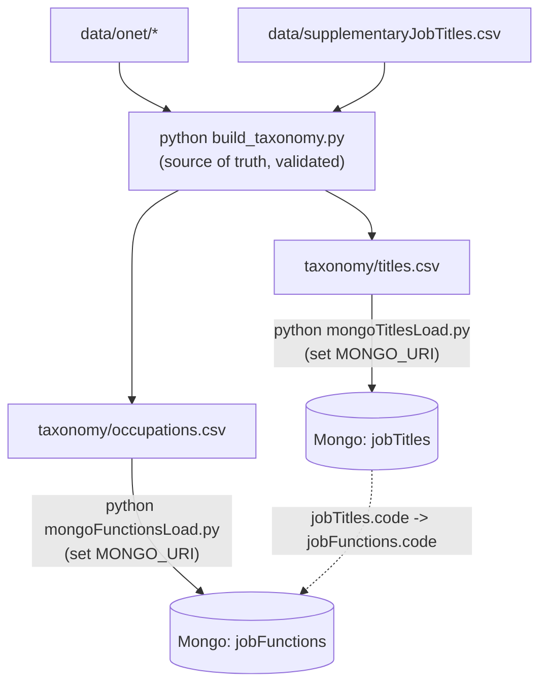

# jobTaxonomy

- [Project Summary](#project-summary)
- [Data model](#data-model)
- [Workflow](#workflow)
- [Setup and build](#setup-and-build)
- [Adding your own job titles](#adding-your-own-job-titles) (`data/supplementaryJobTitles.csv`)
- [Loading into Mongo](#loading-into-mongo)
- [Mongo fuzzy search (Atlas)](#mongo-fuzzy-search-atlas)
- [Background](#background) (O\*NET/SOC schema design)

# Project Summary
This project is designed to process occupational data from the U.S. Department of Labor's O\*NET database and import it into MongoDB. It creates two collections: jobFunctions (one document per O\*NET occupation, like "Marketing Managers") and jobTitles (for specific titles like "Marketing Director").

# Data model

The build produces two datasets, which the loaders import as two Mongo collections:

- `jobFunctions` (from `taxonomy/occupations.csv`): `code` (e.g. `11-1011.00`), `title`, `description`, `jobZone`, `whiteCollar`, the SOC hierarchy fields (see [Background](#background)), and `source`.
- `jobTitles` (from `taxonomy/titles.csv`): `code`, `title`, `shortTitle` and `source`. `jobTitles.code` maps to `jobFunctions.code`.

# Workflow



- `taxonomy/occupations.csv`: every O\*NET occupation with `jobZone`, `whiteCollar` flag and the full SOC hierarchy (major, minor, broad, detailed), derived from `SOC_structure.csv`.
- `taxonomy/titles.csv`: alternate titles (`source=onet`) plus supplementary additions (`source` = the supplement file's name, e.g. `supplementaryJobTitles`).
- The white-collar rule (SOC major groups + Job Zone 4/5) lives in one place: the constants at the top of `build_taxonomy.py`.
- The build exits non-zero if a supplementary title has an unknown code or an occupation is missing from the SOC structure.

# Setup and build

Use this for a first install and again for each new O\*NET release. The result is `taxonomy/*.csv`; loading into Mongo is a separate, optional step (next sections).

1. **Install** (Python 3.9+), in a virtual environment: `python3 -m venv .venv && source .venv/bin/activate && pip install pymongo` (add `mongomock` to run the tests). The build itself needs only the standard library. Run `source .venv/bin/activate` again in each new shell.
2. **Get the O\*NET data** (first install, or a new release): download the text files from https://www.onetcenter.org/db_releases.html and copy `Occupation Data.txt`, `Job Titles.txt` and `Job Zones.txt` into `data/onet/`. The build looks for exactly these names, so if a release renames them, update the `read_tsv(...)` calls in `build_taxonomy.py`. Update `data/onet/SOC_structure.csv` from https://www.onetcenter.org/taxonomy/2019/structure.html.
3. **Build**: `python build_taxonomy.py` and fix anything it reports and rerun until it exits cleanly. This rewrites `taxonomy/*.csv` even when it reports problems, so commit them only after a clean run.

# Adding your own job titles

O\*NET's title list doesn't include every title people really use (e.g. "Founder", "Managing Director"). To add your own, map each one to an O\*NET occupation code in a CSV; they're merged in on every build, so they survive O\*NET refreshes.

`data/supplementaryJobTitles.csv` is an input file, not a script: you never run it. You edit it, then run the build, which reads it.

1. **Edit the file.** Add one line per title, in the form `O*NET-SOC code,Title[,Short title]`, e.g. `11-2011.00,Marketing Officer`.
   - The code must be a full O\*NET code including the `.00` suffix (`11-1011.00`, not `11-1011`). Find it by searching `taxonomy/titles.csv` for a similar title; major groups: https://www.bls.gov/soc/2018/major_groups.htm
   - The first line is a header row (`O*NET-SOC Code,...`) and is skipped; keep it or delete it. Only the first three columns are read; anything after them (such as `Source(s)`) is ignored. Blank lines are skipped.
   - A title that O\*NET already lists for that code (compared ignoring case) is skipped, so it keeps `source=onet`.
2. **Rebuild:** `python build_taxonomy.py`. This merges the file into `taxonomy/titles.csv`, tagging those rows with `source=supplementaryJobTitles` (the file name without `.csv`). The build exits non-zero and lists the offending titles and codes if a code doesn't match an O\*NET occupation, so fix those and rerun.
3. **Check:** `grep supplementaryJobTitles taxonomy/titles.csv` should show your new rows.
4. **Load into Mongo** (optional): `python mongoTitlesLoad.py`.

To use a different or additional file, pass `--supplement`, repeated as needed: `python build_taxonomy.py --supplement data/mine.csv --supplement data/other.csv`. This replaces the default file rather than adding to it, so list `data/supplementaryJobTitles.csv` too if you still want it. The file name becomes the `source` value; `manual` and `onet` are reserved and rejected.

# Loading into Mongo

Optional: only needed to use the data (and Atlas fuzzy search) from Mongo. Run after Setup and build.

1. **Connect**: `export MONGO_URI="mongodb+srv://..."` (credentials and database options are below). The code reads environment variables only and does not load a `.env` file; if you keep the values in one (it is gitignored), run `set -a; source .env; set +a` first.
2. **Load**: `python mongoFunctionsLoad.py` then `python mongoTitlesLoad.py`. Each load replaces the documents this pipeline owns, so a refresh needs no cleanup.

Options and rules:

- Set `MONGO_URI` or `MONGODB_URI`; if it has no credentials or still has Atlas's `<username>`/`<password>` placeholders, `MONGODB_USERNAME` / `MONGODB_PASSWORD` are filled in. Databases and collections are created on first insert. Optional: `MONGO_DB` or `--db` (default `jobTaxonomy`), `--collection` to target a new collection.
- Every document has a `source`. Every non-`manual` document is owned by this pipeline: each load deletes them and reloads from `taxonomy/*.csv`, so titles O\*NET removed disappear on the next load.
- Documents with `source: "manual"` are never touched (`manual` and `onet` are reserved, so a supplement file can't use those names). Add hand-made titles with `source: "manual"`.
- `--include-manual` deletes everything, manual documents too (asks for confirmation, `--yes` skips it).
- `--dry-run` changes nothing. With `MONGO_URI` set it reports how many documents would be deleted and inserted (and applies the shrink guard); without it, it previews the first 20 documents.
- Guards: aborts on an empty load or if the new load is >20% smaller than the owned documents it replaces (`--force` overrides).
- Indexes: the loaders create unique indexes automatically (`jobFunctions.code`; `jobTitles.code` + `title`); the title-to-function `$lookup` joins on `jobFunctions.code`, which that unique index covers, so the join needs nothing else. The Atlas Search indexes you create by hand are described in Mongo fuzzy search: `functions` on `jobFunctions` and `title` on `jobTitles`.
- There is deliberately no supplementary file for `jobFunctions` (unlike job titles). `jobFunctions` mirrors O\*NET occupations one to one, and adding or overriding functions by hand would unbalance the hierarchy and the `jobTitles.code` -> `jobFunctions.code` mapping. To cover a missing title, add it to the supplementary titles instead.
- Tests for these rules: `pip install mongomock && python -m unittest test_loaders`.

# Mongo fuzzy search (Atlas)

Requires the data to be loaded (previous section). Create two Atlas Search indexes, one per collection: `functions` on `jobFunctions` (the taxonomy itself) and `title` on `jobTitles` (title search, with each title mapped back to its function). Both are created by hand in Atlas; the loaders do not create them.

## Job functions (`functions` index)

Searches the 1,016 O\*NET occupations by name or description, e.g. "marketing" finding Marketing Managers, and can filter on `whiteCollar` and the group fields.

1. Create an Atlas Search index on the `jobFunctions` collection (database `jobTaxonomy` by default): Atlas UI > Search > Create Search Index > JSON Editor, **index name `functions`** (the query below refers to it by name; Atlas defaults to `default`, so change it), with this definition:
```json
{
  "mappings": {
    "dynamic": false,
    "fields": {
      "title": { "type": "string" },
      "description": { "type": "string" },
      "majorGroup": { "type": "token" },
      "minorGroup": { "type": "token" },
      "whiteCollar": { "type": "boolean" }
    }
  }
}
```

2. Fuzzy search function titles and descriptions for "marketng manager", white-collar functions only:
```js
db.getCollection("jobFunctions").aggregate([
  { $search: { index: "functions",
      compound: {
        must: [{ text: { query: "marketng manager", path: ["title", "description"],
                         fuzzy: { maxEdits: 2 } } }],
        filter: [{ equals: { path: "whiteCollar", value: true } }]
      } } },
  { $limit: 10 },
  { $project: { _id: 0, code: 1, title: 1, minorGroup: 1, score: { $meta: "searchScore" } } }
])
```

Example output (highest score first; the first 3 of up to 10 results):
```json
{
    "code" : "13-1161.00",
    "title" : "Market Research Analysts and Marketing Specialists",
    "minorGroup" : "Business Operations Specialists",
    "score" : 7.358685493469238
}
{
    "code" : "11-2021.00",
    "title" : "Marketing Managers",
    "minorGroup" : "Advertising, Marketing, Promotions, Public Relations, and Sales Managers",
    "score" : 6.539028167724609
}
{
    "code" : "13-1161.01",
    "title" : "Search Marketing Strategists",
    "minorGroup" : "Business Operations Specialists",
    "score" : 3.9862546920776367
}
```

Not a search index: if you will list functions by hierarchy (e.g. every function in a minor group), also add a regular index. Skip it until a query needs it:
```js
db.getCollection("jobFunctions").createIndex({ majorCode: 1, minorCode: 1 })
```

## Job titles (`title` index)

1. Create an Atlas Search index on the `jobTitles` collection (database `jobTaxonomy` by default): Atlas UI > Search > Create Search Index > JSON Editor, **index name `title`** (the queries below refer to it by name; Atlas defaults to `default`, so change it), with this definition:
```json
{
  "mappings": {
    "dynamic": false,
    "fields": {
      "title": {
        "type": "string"
      }
    }
  }
}
```

2. In the Atlas console, query the `title` index. Here we are searching for the job title "**pesient pabnk**" aka "**bank president**" using fuzzy search
```js
db.getCollection("jobTitles").aggregate([
  {
    $search: {
      index: "title",
      text: {
          "query": "pesient pabnk",
          "path": "title",
          "fuzzy": {
            "maxEdits": 2,
            "maxExpansions": 50,
            "prefixLength": 0
          }
      }
    }
  }
])
```
This returns the matching `jobTitles` documents as stored (`_id`, `code`, `title`, `shortTitle`, `source`), best match first. It does not say which function each title belongs to; step 3 adds that.

3. Let's find all the job functions associated with "**pesient pabnk**" using an aggregate query, results are ordered by highest score.
```js
db.getCollection("jobTitles").aggregate([
  {
    $search: {
      "index": "title",
      "text": {
        "path": "title",
        "query": "pesient pabnk",
        "fuzzy": {
          "maxEdits": 2, // Max single-character edits (insert, delete, substitute, transpose) per term; 2 is the maximum.
          // With maxEdits 1, "cat" matches "cat", "hat", "cut", "cats", "cart" and "coat", but not "cog" or "dog".
          // With maxEdits 2, it also matches "cog" (two substitutions); "dog" needs three edits, so it still does not match.
          "maxExpansions": 50, // Max number of term variations (within maxEdits) generated per query term; the default is 50. Too low a value (e.g. 2) can miss the intended word: "pabnk" never reached "bank".
          "prefixLength": 0 // Number of leading characters that must match exactly. The default value is 0.
          // With maxEdits 1 and prefixLength 2, "cat" matches "cats" and "cart" (both start with "ca") but not "hat" or "cut".
          // With maxEdits 1 and prefixLength 3, "cat" matches only "cat" and "cats".
        }
      }
    }
  },
  {
    $limit: 10
  },
  {
    $lookup: {
      "from": "jobFunctions",
      "localField": "code",
      "foreignField": "code",
      "as": "function"
    }
  },
  {
    $project: {
      "_id": 0,
      "title": 1,
      "function": { $arrayElemAt: ["$function.title", 0] },
      "score": { $meta: "searchScore" }
    }
  }
])
```

Example output of the step 3 query (highest score first; the first 3 of 10 results):
```json
{
    "title" : "Bank President",
    "function" : "Chief Executives",
    "score" : 4.047979354858398
}
{
    "title" : "President",
    "function" : "Chief Executives",
    "score" : 2.950669288635254
}
{
    "title" : "Resident",
    "function" : "Physicians, All Other",
    "score" : 2.950669288635254
}
```

# Background

## O\*NET schema design

O\*NET classifies jobs with the SOC (Standard Occupational Classification), a hierarchy that groups occupations by the work performed, and adds one finer level of its own. The data has five levels (counts are from the current `taxonomy/occupations.csv`):

| Level | Count | Example |
| --- | --- | --- |
| Major group | 23 | `11-0000` Management Occupations |
| Minor group | 98 | `11-1000` Top Executives |
| Broad occupation | 459 | `11-1010` Chief Executives |
| Detailed occupation | 867 | `11-1011` Chief Executives |
| O\*NET-SOC occupation | 1,016 | `11-1011.00` Chief Executives, `11-1011.03` Chief Sustainability Officers |

A level can share its parent's name (Chief Executives appears at three levels). Each O\*NET-SOC occupation becomes one `jobFunctions` document that carries its whole chain: `majorCode`/`majorGroup`, `minorCode`/`minorGroup`, `broadCode`/`broadOccupation` and `detailedCode`.

Job titles are not a SOC level. They are O\*NET's alternate titles (about 54,000, e.g. "President" under `11-1011.00`), and each becomes a `jobTitles` document that points at its occupation by `code`.

"All Other" occupations (e.g. `11-9199.00` Managers, All Other) are SOC catch-alls for jobs that fit no specific occupation in their group.

Source: https://www.onetcenter.org/taxonomy/2019/structure.html
